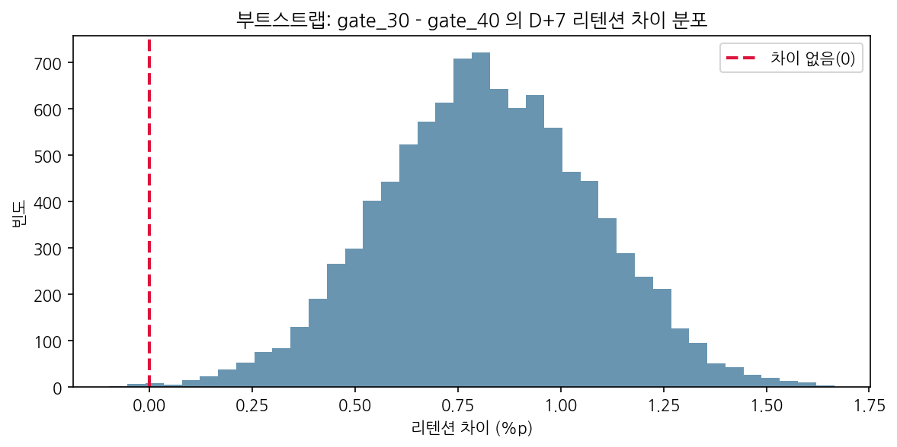
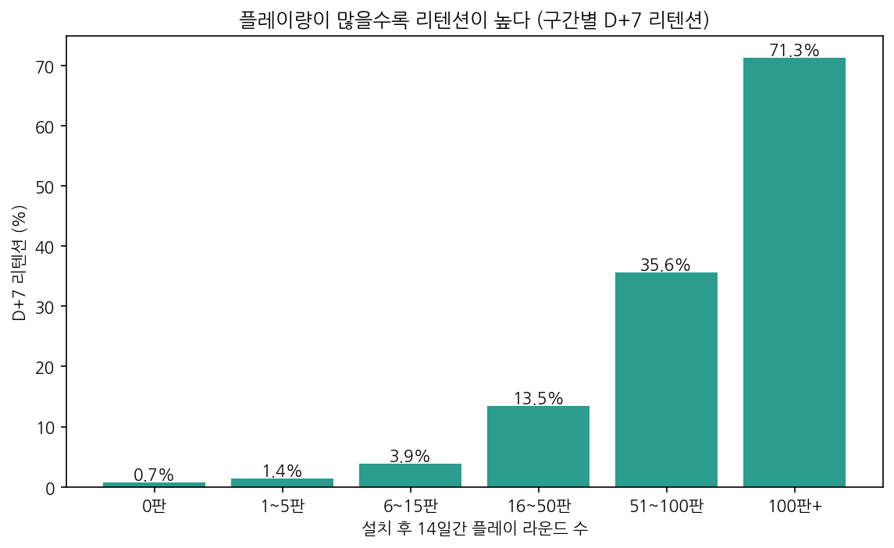
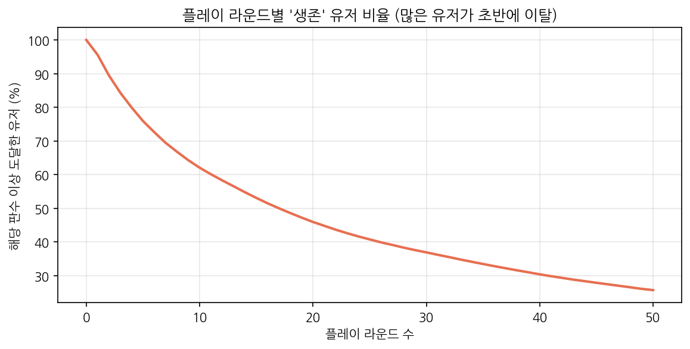

# CookieCats

**모바일 게임 A/B 테스트 검증과 리텐션 개선 실험 설계**

유저 90,189명의 A/B 테스트 결과를 그대로 믿지 않고 **실험이 제대로 배정됐는지부터 검증**한 뒤, 리텐션과 관련된 유저 행동을 찾아 **이를 검증할 후속 실험을 설계**한 프로젝트입니다.

<br>

## 핵심 결과

| 항목 | 결과 |
|---|---|
| A/B 결과 | 관문을 레벨 40으로 늦춘 그룹의 D+7 리텐션이 0.82%p 낮음 (카이제곱 p = 0.0016, 부트스트랩 99.9%) |
| 실험 품질 검증 | 50:50 배정인데 인원 비율이 유의하게 어긋남(SRM, p = 0.0086). 최악의 가정에서도 결론의 방향은 유지되어, 효과를 **0.5 ~ 0.8%p 범위**로 보고 재실험 권장 |
| 유저 행동 | 5판 이하 유저(27.4%)의 D+7 리텐션은 1.3%, 6판 이상은 25.2%. 단, **상관관계**이므로 인과는 실험으로 확인 필요 |
| 후속 실험 설계 | '5판 마일스톤 보상' 실험 설계. +1.0%p 검출에 총 **48,518명** 필요 (유의수준 5%, 검정력 80%) |

<br>

## 문제 정의

Cookie Cats는 일정 레벨에 도달하면 '관문'이 나와 기다리거나 결제해야 다음으로 넘어갈 수 있는 퍼즐 게임입니다.
관문을 레벨 30에서 40으로 늦추면 유저가 더 오래 남을까? 이를 확인하기 위해 진행된 A/B 테스트 데이터를 분석했습니다.

이 프로젝트에서 답하려 한 질문은 세 가지입니다.

1. 관문 위치는 리텐션에 영향을 주는가?
2. 그 실험 결과는 믿을 수 있는가?
3. 리텐션을 높이려면 다음에 무엇을 실험해야 하는가?

<br>

## 분석 과정

### 1단계. 데이터 확인

[Kaggle Cookie Cats A/B 테스트 데이터](https://www.kaggle.com/datasets/yufengsui/mobile-games-ab-testing) (유저 90,189명)

| 컬럼 | 의미 |
|---|---|
| `version` | 실험 그룹 (gate_30: 기존, gate_40: 관문을 늦춘 그룹) |
| `sum_gamerounds` | 설치 후 14일간 플레이한 판수 |
| `retention_1` | 설치 1일 후 재접속 여부 (D+1) |
| `retention_7` | 설치 7일 후 재접속 여부 (D+7) |

- 전체 D+1 리텐션 **44.5%**, D+7 리텐션 **18.6%**
- 플레이 판수 중앙값 16판, 설치 후 한 판도 하지 않은 유저 **4.4%**

<br>

### 2단계. 실험 품질 검증 (SRM 검정)

A/B 결과를 해석하기 전에, 실험이 의도대로 배정되었는지 먼저 확인했습니다.

| 그룹 | 유저 수 | 비중 |
|---|---|---|
| gate_30 | 44,700 | 49.56% |
| gate_40 | 45,489 | 50.44% |

- 50:50 배정이라면 789명 차이는 우연으로 보기 어려웠습니다 (카이제곱 p = **0.0086**).
- 배정이나 데이터 수집 과정에서 한쪽 그룹의 일부 유저가 빠졌을 가능성이 있다는 신호입니다. 빠진 유저가 리텐션이 낮은 유저였다면, 그룹 간 차이가 실제보다 크게 보일 수 있습니다.

<br>

### 3단계. A/B 검정

| 그룹 | D+1 리텐션 | D+7 리텐션 |
|---|---|---|
| gate_30 | 44.82% | 19.02% |
| gate_40 | 44.23% | 18.20% |

두 가지 방법으로 교차 검증했습니다.

| 방법 | D+1 | D+7 |
|---|---|---|
| 카이제곱 검정 | p = 0.0755 (유의하지 않음) | p = **0.0016** (유의함) |
| 부트스트랩 10,000회 | | gate_30이 높을 확률 **99.9%**, 차이 0.82%p (95% 구간 0.32 ~ 1.32%p) |



- 관문을 늦춰도 D+1에는 차이가 없었지만, **D+7 리텐션은 오히려 낮아졌습니다.**
- "관문을 미루면 유저가 더 오래 남을 것"이라는 기대와 반대되는 결과입니다.

<br>

### 4단계. SRM이 결론을 뒤집을 수 있을까 (민감도 분석)

원본 로그를 확인할 수 없는 공개 데이터이므로, **결론에 가장 불리한 가정**에서도 결과가 유지되는지 확인했습니다.
gate_30에서 빠진 789명이 **전부 D+7 이탈자**였다고 가정하고 인원을 맞췄습니다.

| 구분 | gate_30 D+7 | gate_40 D+7 | 차이 | p-value |
|---|---|---|---|---|
| 원래 데이터 | 19.02% | 18.20% | 0.82%p | 0.0016 |
| 최악의 가정 | 18.69% | 18.20% | 0.49%p | 0.0577 |

- 최악의 가정에서도 gate_30이 높아, **결론의 방향은 유지**되었습니다.
- 다만 유의성은 경계선으로 내려와, 효과 크기는 **0.5 ~ 0.8%p 범위**로 보는 것이 정확합니다.
- 결론: 관문을 늦추는 변경은 도입하지 않되, **확정 전 SRM 원인 확인과 재실험을 권장**합니다.

<br>

### 5단계. 플레이량과 리텐션의 관계

| 플레이 판수 | 유저 비율 | D+1 리텐션 | D+7 리텐션 |
|---|---|---|---|
| 0판 | 4.4% | 2.2% | 0.7% |
| 1 ~ 5판 | 23.0% | 7.7% | 1.4% |
| 6 ~ 15판 | 21.1% | 26.5% | 3.9% |
| 16 ~ 50판 | 26.2% | 58.8% | 13.5% |
| 51 ~ 100판 | 11.6% | 80.4% | 35.6% |
| 100판 이상 | 13.7% | 90.0% | 71.3% |



- 5판 이하 유저(27.4%)의 D+7 리텐션은 **1.3%**, 6판 이상 유저(72.6%)는 **25.2%** 였습니다.
- 유저의 **48.5%가 15판 이하**만 플레이했습니다.
- 판수가 늘수록 리텐션이 구간마다 2 ~ 3.5배씩 꾸준히 올랐습니다. 특정 판수에서만 급등하는 임계점은 보이지 않았습니다.



**해석할 때 주의한 점**

`sum_gamerounds`는 설치 후 **14일간**의 플레이 판수입니다. D+7에 돌아온 유저는 그만큼 더 플레이하게 되므로, "많이 플레이해서 남았다"가 아니라 **"남았기 때문에 많이 플레이했다"**일 수도 있습니다.
따라서 이 결과는 **상관관계**이며, "5판을 넘기게 하면 리텐션이 오른다"는 인과는 실험으로 확인해야 합니다.

<br>

### 6단계. 후속 실험 설계: 초반 5판 마일스톤 보상

5단계의 상관관계가 인과인지 확인하기 위한 실험을 설계했습니다.

**필요 표본 수 계산** (기준 D+7 리텐션 18.61%, 유의수준 5%, 검정력 80%, 50:50 배정)

| 최소 검출 효과 | D+7 리텐션 | 그룹당 필요 유저 | 총 필요 유저 |
|---|---|---|---|
| +0.5%p | 18.6% → 19.1% | 96,072 | 192,144 |
| **+1.0%p** | **18.6% → 19.6%** | **24,259** | **48,518** |
| +2.0%p | 18.6% → 20.6% | 6,183 | 12,366 |

- 검출하려는 효과를 절반으로 줄이면 필요한 유저는 약 4배로 늘어납니다.
- 0.5%p를 잡으려면 19만 명이 필요해, **이번 9만 명 실험으로는 0.5%p 수준의 효과를 안정적으로 잡기 어려웠다**는 점도 4단계의 경계선 결과를 설명해 줍니다.
- 보상은 관문 위치보다 직접적인 개입이고, 효과가 1%p보다 작다면 보상 비용 대비 도입 가치가 낮으므로 **+1.0%p를 최소 검출 효과로 설정**했습니다.

**실험 설계서**

| 항목 | 설계 |
|---|---|
| 가설 | 초반 5판 돌파 시 보상을 주면 D+7 리텐션이 오른다 |
| 대상 | 신규 설치 유저 |
| 배정 | 설치 시점에 50:50 무작위 배정 (대조군: 보상 없음, 처치군: 5판 돌파 보상) |
| 핵심 지표 | D+7 리텐션 |
| 확인 지표 | 5판 돌파율 (보상이 실제로 행동을 바꿨는지 확인) |
| 가드레일 지표 | D+1 리텐션, 결제 전환율 (보상이 다른 지표를 해치지 않는지 확인) |
| 최소 검출 효과 | +1.0%p (18.6% → 19.6%) |
| 표본 크기 | 그룹당 24,259명, 총 48,518명 |

**분석 전 확인할 것**
- 이번 실험에서 SRM이 발견되었으므로, 결과를 보기 전에 배정 비율부터 확인한다.
- 처치군의 5판 돌파율이 올랐는지 먼저 확인한다. 돌파율이 오르지 않았다면 리텐션 차이를 보상 효과로 해석하지 않는다.

**판단 기준**
- D+7 리텐션이 유의하게 오르고 가드레일 지표가 유지되면 전체 적용
- 5판 돌파율은 올랐지만 리텐션이 오르지 않으면, 5판 돌파는 리텐션의 **원인이 아니라 결과**였다고 판단하고 다른 개입을 검토

<br>

## CRM 제안

모든 제안은 **실험으로 검증한 뒤 확대**하는 것을 원칙으로 합니다.

| 우선순위 | 제안 | 근거 | 검증 지표 |
|---|---|---|---|
| 1 | 초반 관문을 늦추지 않기 | A/B 결과 gate_40의 D+7 리텐션이 0.5 ~ 0.8%p 낮음 | D+7 리텐션 |
| 2 | 초반 5판 마일스톤 보상 | 5판 이하 유저의 D+7 리텐션 1.3% (6단계 실험으로 검증) | 5판 돌파율, D+7 리텐션 |
| 3 | 설치 후 미플레이 유저 대상 복귀 메시지 | 설치 후 한 판도 하지 않은 유저 4.4% | 첫 플레이 전환율 |

<br>

## 한계

- 공개 데이터라 SRM의 원인(배정 오류, 로그 누락 등)을 직접 확인할 수 없어, 민감도 분석으로 결론의 범위만 확인했습니다.
- 플레이 판수는 14일 누적값이라 D+7 리텐션과 시간 순서가 겹칩니다. 판수와 리텐션의 관계를 인과로 해석할 수 없습니다.
- 후속 실험은 설계까지만 진행했으며, 실제 실행 결과는 아닙니다.
- 본 프로젝트는 공개 데이터셋을 활용한 분석과 실험 설계이며, 실제 캠페인 성과가 아닙니다.

<br>

## 파일 구성

```
cookiecats-retention-crm/
├── CookieCats.ipynb
├── retention_bootstrap.png
├── retention_by_engagement.png
├── survival_curve.png
└── README.md
```

**사용 기술**: Python (pandas, numpy, scipy, statsmodels, matplotlib), 카이제곱 검정, 부트스트랩, SRM 검정, 민감도 분석, 검정력 분석
